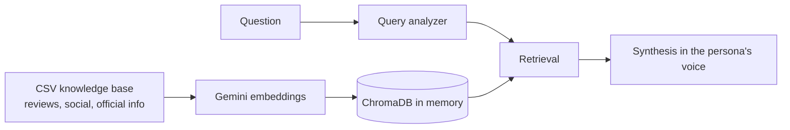

# Data Persona Interativa: interview a persona built from real customer data

> **PT-BR:** Uma persona com quem você conversa, que responde só com base em dados reais (reviews, comentários de redes sociais e informações oficiais), usando RAG com agentes. Versão de demonstração com dados públicos sobre a Nomad.

Personas usually live in a slide and go stale. This app turns the raw material behind them (reviews, social comments, survey answers) into a persona that marketing and product teams can question in natural language, and that answers only from that material.

## How it works



- The knowledge base is filtered by product (Conta Internacional, Investimentos no Exterior, App).
- A LangGraph agent analyses the question, retrieves the relevant excerpts and writes the answer as the persona.
- The app suggests questions to start the interview.

## Stack

Python · Streamlit · LangChain · LangGraph · ChromaDB · Gemini (LLM and embeddings)

## Run it yourself

```bash
pip install -r requirements.txt
# .streamlit/secrets.toml → GEMINI_API_KEY = "..."
streamlit run app.py
```

To use your own data, replace the CSVs in `data/` with files that have `text` and `product` columns.
